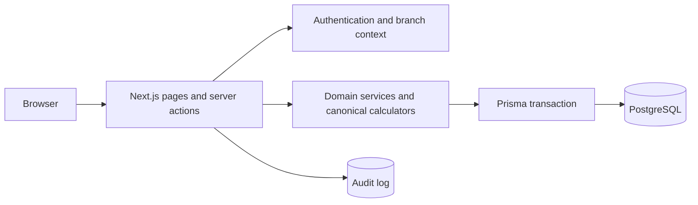
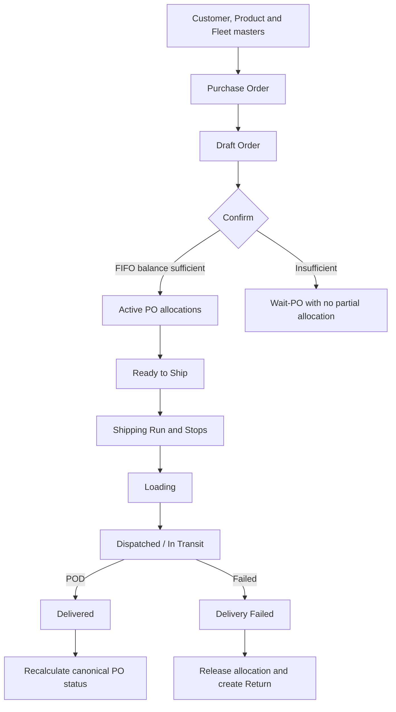
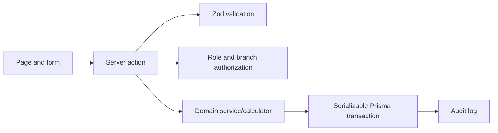

# Developer Guide — OPT Shipping Work Plan v2

คู่มือนี้ใช้สำหรับนักพัฒนาที่ต้องการติดตั้งระบบในเครื่อง พัฒนาฟังก์ชัน ทดสอบ migration และส่งการเปลี่ยนแปลงกลับเข้าโครงการบน GitHub

> สถานะ: ระบบเหมาะสำหรับ development และ BB pilot/UAT เท่านั้น ยังไม่ผ่าน Production Go-Live gates ทั้งหมด ดูหลักฐานล่าสุดใน [TestEvidence.md](./TestEvidence.md)

## 1. Technology stack

| Layer | Technology |
|---|---|
| Web | Next.js 15 App Router, React 19, TypeScript |
| Validation | Zod |
| Database | PostgreSQL 16 |
| ORM/migrations | Prisma 6 |
| Authentication | Signed session cookie with JOSE; bcrypt password hashes |
| Tests | Vitest |
| CI | GitHub Actions |
| Local infrastructure | Docker Compose |

Runtime flow:



## 2. Repository map

```text
shipping-workplan/
├── .github/workflows/       GitHub Actions
├── prisma/
│   ├── migrations/          immutable, ordered database migrations
│   ├── schema.prisma        database schema
│   └── seed.ts              branches, vehicle classes, optional admin
├── scripts/                 reconciliation and operational scripts
├── src/app/                 Next.js routes, pages and server actions
├── src/lib/auth/            authentication, authorization, branch context
├── src/lib/domain/          reusable business rules and services
├── public/                  static assets
├── README.md                end-user manual, rendered by the Help page
└── TestEvidence.md          actual executed evidence and open gates
```

Business calculations should live in `src/lib/domain`, not be duplicated in pages. Pages are read models and interaction surfaces; server actions enforce authorization, validate input and mutate data transactionally.

## 3. Prerequisites

- Node.js 20 or a newer project-supported LTS release
- npm 10+
- Docker Desktop or PostgreSQL 16
- Git

Never commit `.env`, production data, database dumps, credentials, private keys, customer files or POD media.

## 4. First local setup

```bash
git clone <repository-url>
cd shipping-workplan
npm ci
cp .env.example .env
docker compose up -d postgres
npx prisma migrate deploy
npx prisma generate
npm run db:seed
npm run dev
```

PowerShell equivalent for the environment file:

```powershell
Copy-Item .env.example .env
```

Before running the seed, replace `AUTH_SECRET`, `SEED_ADMIN_EMAIL` and `SEED_ADMIN_PASSWORD` in `.env`. Generate an authentication secret locally, for example with `openssl rand -base64 48`. The seed skips admin creation if the example password remains unchanged.

Open `http://localhost:3000`. Confirm the API health endpoint at `http://localhost:3000/api/health`.

## 5. Environment variables

| Variable | Required | Purpose |
|---|---:|---|
| `DATABASE_URL` | Yes | PostgreSQL connection string |
| `AUTH_SECRET` | Yes | Signs and verifies sessions; use at least 32 random characters |
| `SEED_ADMIN_EMAIL` | Seed only | Local administrator email |
| `SEED_ADMIN_PASSWORD` | Seed only | Local administrator password; never reuse a real password |

`.env.example` contains development-only placeholders. Production secrets belong in an approved secret manager, not GitHub source files or build logs.

## 6. Core domain workflow



Important invariants:

- Every write is restricted by role and active branch.
- FIFO allocation is deterministic and all-or-nothing.
- Active allocations must not exceed PO-item quantity.
- Cancellation and Delivery Failed release allocations; records are retained for audit.
- Stock history is append-only. Correct mistakes with compensating movements, never by deleting ledger entries.
- A run may complete only when every stop is Delivered or Delivery Failed.
- `Order.poId` remains a compatibility field; `OrderAllocation` is canonical when `DCP001_FIFO` is enabled.

## 7. DCP-001 BB pilot

The additive migration introduces:

- `OrderAllocation`
- `InventoryLocationBalance`
- `BranchFeatureFlag`

Canonical rules are in `src/lib/domain/canonical.ts`; transactional allocation and PO recalculation are in `src/lib/domain/allocation-service.ts`.

Safe rollout sequence:

```bash
npx prisma migrate deploy
npm run dcp001:reconcile
```

The reconciliation command is dry-run by default. Review `conflicts` and totals before any apply. The following command mutates the connected database and enables the BB pilot, so do not run it against a shared or production database without an approved change window and backup:

```bash
npm run dcp001:apply-bb
```

Run the dry-run again afterward. A clean, idempotent result reports zero new allocation/location rows and zero conflicts. Feature flags are branch-scoped; do not enable another branch merely by copying the BB record.

## 8. Development workflow

1. Read [README.md](./README.md), [TestEvidence.md](./TestEvidence.md) and active design-change proposals. If a separate DesignSpec/TestSpec is supplied for the change, treat it as required input and add it to the pull request when redistribution is permitted.
2. Create a short-lived branch from the current default branch.
3. Add or update domain tests before changing a central calculation.
4. Keep schema changes additive where possible and create a new migration.
5. Enforce authorization and branch filtering inside server actions, not only in UI controls.
6. Run all quality gates locally.
7. Update user/developer documentation and `TestEvidence.md` only with results actually executed.
8. Open a pull request using [CONTRIBUTING.md](./CONTRIBUTING.md).

Recommended branch names: `feat/fifo-preview`, `fix/allocation-release`, `docs/developer-setup`.

## 9. Database changes

For local schema development:

```bash
npx prisma migrate dev --name descriptive_change_name
npx prisma generate
```

For CI, staging and controlled deployments:

```bash
npx prisma migrate deploy
```

Rules:

- Never edit or remove an applied migration.
- Never use `prisma db push` as a deployment replacement.
- Include backfill/reconciliation logic when existing rows need a new canonical representation.
- Test forward migration against a disposable database and document rollback/compensation.
- Treat destructive column/table changes as a separate reviewed design proposal.

## 10. Tests and quality gates

```bash
npm run check
npm run build
```

`npm run check` runs lint, TypeScript, Prisma validation and unit tests. A pull request is not ready when any command fails.

Test layers expected for new work:

| Change | Minimum evidence |
|---|---|
| Pure calculation | Unit tests including boundaries |
| Server action/workflow | Authorization, state-transition and failure-path tests |
| Schema/backfill | Migration on disposable PostgreSQL plus reconciliation |
| Concurrency-sensitive allocation | PostgreSQL integration test with competing transactions |
| UI workflow | Role/branch E2E or documented manual UAT |
| Security-sensitive change | Abuse cases and reviewer sign-off |

Do not label unexecuted specification cases as PASS. Keep environment, commit SHA, test data and remaining limitations in `TestEvidence.md`.

## 11. Adding a feature safely

Use this dependency direction:



- Prefer small pure calculators that can be unit tested.
- Use a serializable transaction for numbering, allocation and cross-record state transitions.
- Make retries bounded and limited to recognized serialization conflicts.
- Make commands idempotent where users or integrations may retry.
- Preserve auditability: release/compensate instead of deleting historical facts.
- Add feature flags for high-risk behavior changes and define an explicit exit criterion.

## 12. Authentication, RBAC and branch isolation

Never rely on hidden buttons as authorization. Every server mutation must:

1. load the authenticated context;
2. require one of the allowed roles;
3. scope reads and writes to the active/granted branch;
4. reject cross-branch identifiers;
5. create an audit record for material business changes.

Current roles include `SUPER_ADMIN`, `BRANCH_ADMIN`, `CS`, `PURCHASING`, `WAREHOUSE`, `LOGISTICS`, `PRODUCTION` and `DRIVER`.

## 13. Troubleshooting

| Symptom | Check |
|---|---|
| Prisma cannot connect | PostgreSQL container health, port 5433 and `DATABASE_URL` |
| Prisma types are stale | Run `npx prisma generate`, then restart the dev server |
| Migration timeout | Check for another migration process; do not terminate unknown production sessions |
| Login seed missing | Set non-default seed credentials and rerun `npm run db:seed` |
| Page shows no records | Check active branch and branch grants |
| Order becomes Wait-PO | Verify customer/product match and total active FIFO balance |
| WMS shows Never synced | No successful `WmsSyncLog` exists for the active branch |

## 14. Public repository readiness

Before changing repository visibility to public:

- complete a secret-history scan, not only a current-file scan;
- verify `.env`, dumps, customer data and generated POD files were never committed;
- verify the chosen [Apache License 2.0](./LICENSE) remains appropriate for the copyright owner and dependencies;
- configure branch protection and required CI checks;
- enable Dependabot/automated dependency alerts and secret scanning where available;
- publish a supported-version and disclosure policy in [SECURITY.md](./SECURITY.md);
- replace organization-specific test data with synthetic examples;
- have the Product Owner and IT/Security review the public content.

This repository uses Apache License 2.0, which permits use, modification and redistribution subject to its notice, license and patent terms. Contributors must not add code or assets under incompatible terms.

## 15. Related documents

- [README.md](./README.md) — user manual and Help content
- [DesignChangeProposal-001.md](./DesignChangeProposal-001.md) — approved canonical FIFO/inventory proposal
- [TestEvidence.md](./TestEvidence.md) — verified test evidence and release decision
- [CONTRIBUTING.md](./CONTRIBUTING.md) — contribution and pull-request process
- [SECURITY.md](./SECURITY.md) — responsible security reporting
