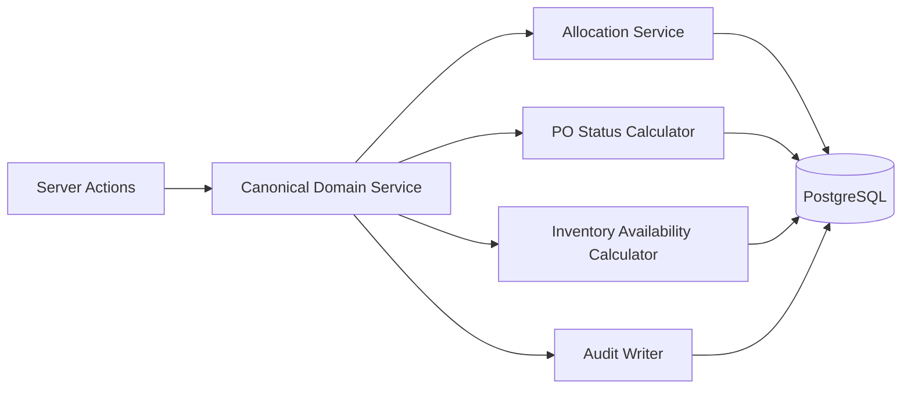
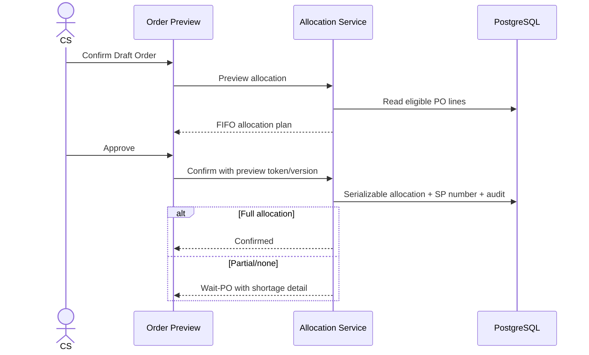

# Design Change Proposal DCP-001

## Canonical Business Rules, Multi-PO FIFO Allocation and Inventory Availability

## 1. Document control

| Field | Value |
|---|---|
| Project | OPT Shipping Work Plan v2 |
| Proposal | DCP-001 |
| Status | **Approved for additive implementation phases 1–3 — 20 July 2026** |
| Prepared | 20 July 2026 |
| Baseline revision | `63c15ab3ea9962de7edd0537640bb5ad5acb92d4` |
| Related documents | `README.md`, `designspec.md`, `TestSpec.md`, `TestEvidence.md` |
| Change class | Business rule + data model + UX extension |
| Production impact | High; migration and compatibility controls required |

No implementation or database migration described by this proposal may be applied until the approval record in section 15 is completed.

## 2. Purpose

This proposal strengthens three goals already defined by README and DesignSpec without removing current capabilities:

1. make status, PO balance and inventory calculations use one canonical rule set;
2. allocate one Order across multiple eligible PO lines using FIFO without overselling;
3. show On Hand, Reserved, Available and WMS freshness as distinct, traceable facts.

The proposal preserves branch isolation, RBAC, immutable audit/stock ledgers, SP/DP numbering, Order split lineage, Delivery/POD/Return workflows and existing manual inventory movements.

## 3. Current state and problem statement

### 3.1 Rules are distributed

PO status and released quantity are currently calculated in Order confirmation, Delivery completion and PO list code. Although the implemented formulas are aligned for the current vertical slice, adding FIFO, WMS or replacement Orders would increase the risk of inconsistent results.

### 3.2 One Order points to one PO

`Order.poId` supports the current workflow but cannot represent an Order quantity supplied by two or more PO lines. Full FIFO therefore cannot be implemented safely without an allocation ledger.

### 3.3 Inventory mixes fact and location

`Inventory` stores one balance per Product/Branch and one `zone` value. This is adequate for the current vertical slice but cannot show Main, Return, Quarantine or WMS snapshots independently. Reserved and Available are not yet exposed as first-class computed values.

### 3.4 WMS freshness is absent

The product goal requires planners to know the latest WMS synchronization time. The schema has `WmsSyncLog`, but current operational pages do not show freshness or distinguish stale/external data from manual ledger data.

## 4. Non-negotiable compatibility principles

- Existing `Order.poId` remains readable during migration and rollback.
- Existing Orders, PO lines, SP/DP numbers and audit records are never renumbered.
- Existing StockMovement records remain immutable.
- Existing manual Inbound/Outbound/Adjustment and Return-In actions remain available.
- Existing branch and role checks remain server-side.
- Existing accessible stop ordering remains available if drag-and-drop is added later.
- No historical Order is silently reallocated.
- New functionality is enabled per branch through a feature flag after reconciliation.

## 5. Proposed canonical business rule service

Create a server-only domain service used by every action and read model that mutates or reports PO, Order and Inventory state.

### 5.1 Canonical Order quantities

| Quantity | Definition |
|---|---|
| Requested | Current Order quantity excluding Split source records |
| Allocated | Sum of active `OrderAllocation.allocatedQty` |
| Unallocated | `max(0, Requested - Allocated)` |
| Delivered | Allocated quantity belonging to Delivered Orders |
| Failed | Quantity belonging to Delivery Failed Orders; allocation released unless policy says otherwise |

### 5.2 Canonical PO quantities

| Quantity | Definition |
|---|---|
| Original | Sum of `PurchaseOrderItem.originalQty` |
| Allocated | Sum of active allocations for the PO item |
| Delivered | Sum of allocations whose Order is Delivered |
| Available | `max(0, Original - Allocated)` |

### 5.3 Canonical PO status

| Condition | Status |
|---|---|
| Manually closed by authorized user | Closed |
| Original > 0 and Delivered >= Original | Fulfilled |
| Allocated > 0 or Delivered > 0 | Partially Fulfilled |
| Otherwise | Open |

PO status must not be edited directly except the explicit Close/Reopen workflow. Every allocation, cancellation, delivery failure, delivery completion and approved amendment triggers recalculation inside the same transaction.

### 5.4 Canonical Run completion rule

The current implemented rule is proposed as authoritative:

> A Dispatched Run can become Completed only when every Stop is terminal through either POD/Delivered or Delivery Failed.

This replaces the older DesignSpec wording that allowed Run completion to mark unresolved Orders Delivered automatically. No Order may become Delivered without a successful delivery outcome.

## 6. Proposed multi-PO FIFO allocation model

### 6.1 New entity: OrderAllocation

| Field | Type | Rule |
|---|---|---|
| id | cuid | Primary key |
| orderId | string | Required; indexed |
| poItemId | string | Required; indexed |
| allocatedQty | decimal(18,3) | Greater than zero |
| allocationSequence | integer | FIFO order within Order |
| status | enum-like string | Active, Released |
| allocatedAt | datetime | Immutable creation time |
| releasedAt | datetime nullable | Set when released |
| releaseReason | string nullable | Cancellation, DeliveryFailed, Amendment, Manual |
| createdById | string | Actor or system account |

Proposed constraints:

- unique `(orderId, poItemId, allocationSequence)`;
- active allocation quantity for a PO item must never exceed its original quantity;
- active allocation quantity for an Order must never exceed Order quantity;
- allocation mutation runs in a Serializable transaction with bounded retry;
- Released allocations remain for traceability and are not deleted.

### 6.2 FIFO eligibility

An eligible PO line must:

- belong to the active branch;
- belong to the same Customer and Product as the Order;
- belong to PO status Open or Partially Fulfilled;
- have positive available quantity;
- not be manually held or closed;
- use the same unit, unless an approved conversion exists.

FIFO sort order:

1. PO date ascending;
2. expected delivery date ascending, null last;
3. PO creation time ascending;
4. PO line ID ascending as deterministic tie-breaker.

### 6.3 Confirmation flow

Recommended policy: confirmation is all-or-nothing. If the full Order quantity cannot be allocated, status becomes Wait-PO and no active allocation is created. Partial allocation may be reconsidered later as a separately approved feature.

### 6.4 Existing `Order.poId`

Compatibility stages:

1. **Stage A:** Add allocation table; keep `Order.poId` unchanged.
2. **Stage B:** Backfill one allocation for eligible existing Orders with `poId`.
3. **Stage C:** New confirmations write allocations and set `Order.poId` only when exactly one PO is used.
4. **Stage D:** Reads prefer allocations and fall back to `Order.poId` for historical records.
5. **Future:** Deprecate but do not immediately remove `Order.poId`.

## 7. Proposed inventory availability model

### 7.1 Preserve aggregate Inventory

`Inventory(productId, branchId)` remains the aggregate balance for backward compatibility.

### 7.2 New entity: InventoryLocationBalance

| Field | Type | Rule |
|---|---|---|
| id | cuid | Primary key |
| inventoryId | string | Aggregate inventory reference |
| zone | string | MAIN, RETURN, QUARANTINE, etc. |
| bin | string nullable | Optional physical bin |
| onHand | decimal(18,3) | Derived from location movements |
| source | string | Manual, WMS, Production, Return |
| sourceUpdatedAt | datetime nullable | External source timestamp |
| updatedAt | datetime | Local update time |

Unique `(inventoryId, zone, bin)` using a normalized non-null bin key in implementation.

### 7.3 Availability calculation

| Metric | Formula |
|---|---|
| On Hand | Sum of usable location balances; excludes Quarantine/Scrap |
| Reserved | Sum of allocated quantity for Confirmed, Ready to Ship and In Transit Orders |
| Available | `max(0, On Hand - Reserved)` |
| Shortage | `max(0, Reserved - On Hand)` |

Reserved and Available are calculated read models, not manually editable columns.

### 7.4 Return behavior

- Delivery Failed creates Pending Return and releases PO allocation.
- Received Return moves to RETURN or QUARANTINE location with no usable-stock increase.
- Restock resolution creates a movement from RETURN/QUARANTINE to MAIN and increases usable On Hand.
- Scrap resolution creates an outbound/scrap movement.
- Replace resolution creates a replacement-work item; replacement Order creation requires user confirmation.

The current `Return-In` behavior will be migrated without deleting its ledger entry. Existing aggregate On Hand remains correct.

## 8. Proposed WMS freshness model

### 8.1 Source policy

WMS is authoritative for warehouse physical On Hand after integration activation. Shipping Work Plan remains authoritative for reservations, planning, Runs, POD, Returns and audit.

Manual inventory adjustments remain enabled only for authorized Warehouse/Admin roles and must require a reason. When WMS mode is active, manual adjustments are queued for reconciliation rather than silently overwriting WMS values.

### 8.2 Freshness states

| State | Default threshold | UI behavior |
|---|---|---|
| Fresh | Last successful sync ≤15 minutes | Green; normal planning |
| Delayed | >15 and ≤60 minutes | Amber warning; confirmation allowed with acknowledgement |
| Stale | >60 minutes | Red; Order confirmation/Dispatch requires override role and reason |
| Never synced | No successful record | Grey; clearly marked Manual/Unknown |

Thresholds must be branch-configurable. The values above are proposed defaults, not final policy.

### 8.3 WMS sync contract

Initial delivery should use Preview/Confirm file import before API/Webhook:

1. upload CSV/XLSX;
2. validate branch, ERP code, zone, quantity and source timestamp;
3. show created/updated/rejected/conflict preview;
4. require authorized confirmation;
5. write location snapshot/movements and `WmsSyncLog` atomically;
6. provide downloadable row-error file;
7. display last success, last failure and row counts.

## 9. UX/UI changes

### 9.1 Order confirmation preview

Display before Confirm:

- requested quantity;
- FIFO PO lines and allocated quantity per line;
- unallocated shortage;
- On Hand, Reserved and Available;
- WMS freshness and last successful sync;
- blocking warnings and required acknowledgement.

### 9.2 PO detail

Display Original, Active Allocated, Delivered, Available and allocation drill-down. Existing Contracted/Released/Balance columns remain until users approve the new terminology.

### 9.3 Inventory page

Retain the aggregate On Hand table and movement ledger. Add expandable location balances and freshness badge. Do not permit direct balance editing.

### 9.4 Exception Workbench

Add a consolidated queue for:

- Wait-PO shortages;
- stale WMS data;
- negative/invalid source snapshots;
- allocation conflicts;
- license expiry;
- missing POD;
- unresolved Returns.

This view adds capability but does not replace existing module pages.

## 10. Security and audit requirements

- All previews and confirms are branch-scoped server-side.
- Preview tokens include branch, user, input hash and expiry.
- Confirm rejects stale previews if underlying PO/inventory version changed.
- Allocation create/release records are immutable.
- Override of stale WMS requires role, reason and audit event.
- WMS files are stored temporarily with retention and access rules; no public URLs.
- Logs must not contain credentials, tokens, customer personal data or uploaded file bodies.

## 11. Migration plan

### Phase 1 — Additive schema

- Add `OrderAllocation` and `InventoryLocationBalance`.
- Add required indexes and feature flags.
- No removal or behavior change.

### Phase 2 — Backfill and reconcile

- Create one allocation for eligible historical non-terminal Orders linked to one PO.
- Mark ambiguous/oversold records for manual reconciliation.
- Seed location balance from current aggregate Inventory with source `Legacy`.
- Produce reconciliation report before activation.

### Phase 3 — Dual read/write pilot

- BB branch only.
- New confirmations write allocation records.
- Compare legacy and canonical PO calculations; block activation on mismatch.
- Inventory UI shows both aggregate and location totals with discrepancy warning.

### Phase 4 — Canonical activation

- Enable canonical reads for BB after UAT acceptance.
- Expand one branch at a time.
- Keep compatibility fallback through at least one release cycle.

## 12. Rollback plan

- Disable feature flags for FIFO/location balances/WMS freshness independently.
- Revert reads to legacy `Order.poId` and aggregate Inventory.
- Do not delete allocation or location records; mark new allocations inactive only through audited release.
- Do not reverse StockMovement records by deletion; create compensating movements.
- Preserve migrations; application rollback must be forward-compatible with additive tables.
- Export reconciliation snapshot before and after pilot activation.

## 13. Acceptance criteria

### Canonical rules

- Every PO status view and mutation uses the same calculator.
- Delivery Failed releases allocation exactly once.
- Run cannot complete with unresolved Stops.
- Recalculation is transactionally consistent with the triggering mutation.

### FIFO allocation

- One Order can allocate across at least two PO lines.
- Deterministic FIFO ordering is reproducible.
- Concurrent confirmations cannot exceed any PO line quantity.
- Insufficient total balance creates Wait-PO with zero active allocation.
- Cancellation and Delivery Failed release allocation exactly once.
- Existing single-PO Orders remain readable and auditable.

### Inventory availability

- Available equals usable On Hand minus active reservation.
- Quarantine and Scrap do not count as usable On Hand.
- Restock changes usable On Hand through movements only.
- WMS freshness timestamp and state appear in Order and Inventory views.
- Stale-data override is role-controlled and audited.

### Quality gates

- Unit tests for calculations and date/freshness boundaries.
- PostgreSQL integration tests for concurrent allocation and release.
- Migration/backfill reconciliation with zero unexplained variance.
- Role/branch E2E tests.
- Production build and CI pass.
- Process-owner UAT sign-off for CS, Purchasing, Warehouse and Logistics.

## 14. Risks and mitigations

| Risk | Impact | Mitigation |
|---|---|---|
| Historical PO data cannot be allocated unambiguously | Incorrect balance | Reconciliation queue; never guess |
| Dual calculations diverge | Operational confusion | Shadow comparison and branch feature flag |
| Concurrent allocation oversells PO | Contract breach | Serializable transaction, constraints and retry |
| WMS snapshot arrives late/out of order | Wrong availability | Source timestamp/version and stale rejection |
| Location totals differ from aggregate | Wrong stock | Reconciliation report and activation gate |
| New terminology confuses users | Adoption delay | Keep old labels during pilot with tooltips/mapping |
| Rollback loses trace | Audit failure | Additive schema and compensating records only |

## 15. Decisions requested from System Designer

Please approve or revise each item before implementation:

| ID | Proposed decision | Approval |
|---|---|---|
| DCP-001-D1 | Run Completed requires every Stop to have POD/Delivered or Delivery Failed | Approved |
| DCP-001-D2 | FIFO confirmation is all-or-nothing; shortage produces Wait-PO | Approved |
| DCP-001-D3 | Delivery Failed releases active PO allocation | Approved |
| DCP-001-D4 | WMS becomes authoritative for physical On Hand after branch activation | Approved |
| DCP-001-D5 | Default freshness: Fresh ≤15m, Delayed ≤60m, Stale >60m | Approved |
| DCP-001-D6 | Preserve `Order.poId` compatibility for at least one release cycle | Approved |
| DCP-001-D7 | Pilot additive schema and canonical calculations at BB first | Approved |
| DCP-001-D8 | Add Exception Workbench without replacing current module pages | Approved |

## 16. Approval record

| Role | Name | Decision | Date | Notes |
|---|---|---|---|---|
| System Designer | User approval recorded in Codex task | Approve D1–D8 | 20 July 2026 | Authorizes additive phases 1–3; no production activation |
| Product Owner | User approval recorded in Codex task | Approve D1–D8 | 20 July 2026 | Reconciliation/UAT gates remain |
| CS/Purchasing Process Owner |  | Approve / Revise / Reject |  |  |
| Warehouse Process Owner |  | Approve / Revise / Reject |  |  |
| Logistics Process Owner |  | Approve / Revise / Reject |  |  |
| IT/Security |  | Approve / Revise / Reject |  |  |

Approval statement:

> I approve DCP-001 decisions recorded in section 15 and authorize additive implementation phases 1–3. Production activation remains subject to reconciliation, UAT and production-readiness gates.
