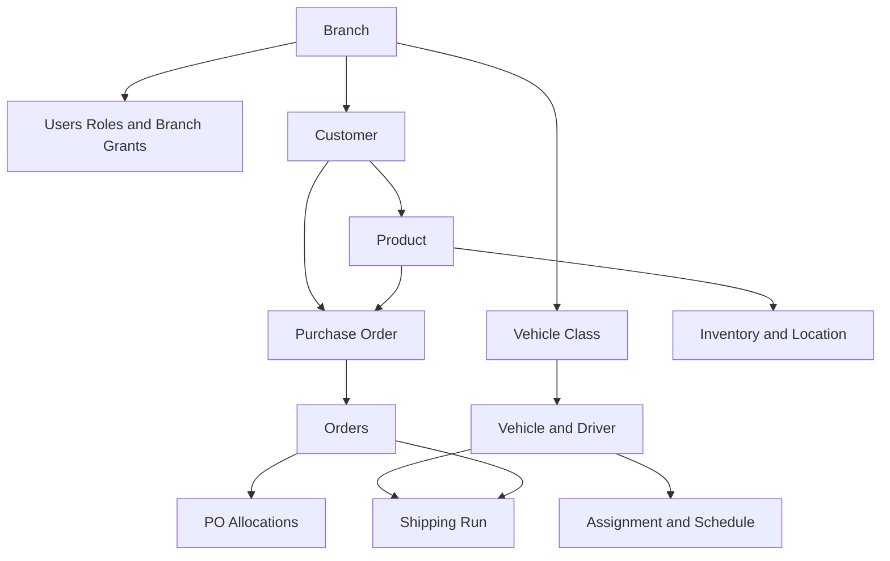
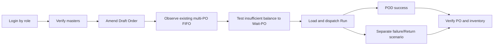

# Initial Data and Realistic UAT Guide

เอกสารนี้อธิบายข้อมูลเริ่มต้นที่ต้องมี ลำดับการนำเข้า ชุดข้อมูลสังเคราะห์ และวิธีตรวจสอบก่อนเริ่มทดสอบ OPT Shipping Work Plan

> ข้อมูลตัวอย่างทั้งหมดเป็นข้อมูลสังเคราะห์ ห้ามแทนที่ด้วยข้อมูลลูกค้า พนักงาน เลขทะเบียน ใบขับขี่ หรือข้อมูลส่วนบุคคลจริงใน public repository

## 1. ระดับข้อมูลเริ่มต้น

| ระดับ | จำเป็น | ข้อมูล | เหตุผล |
|---|---:|---|---|
| Foundation | ต้องมี | Branch, Vehicle Class, Super Admin | ใช้กำหนด scope, timezone, currency และเข้าระบบ |
| Access control | ต้องมี | User, Role, User-Branch grant | ทุกการทำงานถูกจำกัดตามบทบาทและสาขา |
| Commercial master | ต้องมี | Customer, Product | PO/Order ต้องอ้างข้อมูลหลักทั้งสองชุด |
| Fleet master | ต้องมีสำหรับ Delivery | Vehicle, Driver, Driver Class, Assignment/Schedule | ใช้สร้าง Run และมอบหมายคนขับ |
| Opening operations | แนะนำ | PO และ PO Items | ทำให้ทดสอบ balance/FIFO/Wait-PO ได้ |
| Stock opening | แนะนำ | Inventory, Location Balance, Opening Movement | ทำให้เห็น On Hand/Reserved/Available ที่ตรวจสอบย้อนกลับได้ |
| UAT transactions | สำหรับทดสอบ | Draft/Confirmed/Ready Orders, Allocation, Planned Run | เปิด scenario แบบเหมือนจริงโดยไม่ต้องกรอกทุกขั้นด้วยมือ |
| Integration reference | เมื่อมี contract | WMS sync, RM mapping, ERP export setup | ไม่ควรเดารูปแบบก่อนมี sample/owner approval |

## 2. Dependency order



ห้ามเปลี่ยนลำดับแบบสุ่ม เพราะ schema ใช้รหัสภายในเชื่อมกัน แม้บางตารางยังไม่มี database foreign key แต่ business logic ถือว่าความสัมพันธ์ต้องมีจริง

## 3. Required fields and validation

### 3.1 Branch

| Field | Example | Rule |
|---|---|---|
| `code` | `UAT` | ไม่ซ้ำ, สั้นและคงที่ |
| `name` | `Synthetic UAT Branch` | ชื่อแสดงผล |
| `country` | `TH` | ISO-like country code |
| `currency` | `THB` | สกุลเงินของสาขา |
| `timezone` | `Asia/Bangkok` | IANA timezone |
| `taxRate` | `0.07` | decimal ไม่ใช่ 7 |

### 3.2 Users and roles

ผู้ใช้หนึ่งคนมีหลาย role และหลาย branch grant ได้ ทุกบัญชีทดสอบใช้โดเมน `.example.invalid` และรับ password จาก environment เท่านั้น ไม่เก็บ password ในเอกสารหรือ Git

| Role | Test account pattern | Main test responsibility |
|---|---|---|
| `BRANCH_ADMIN` | `branch-admin@uat.example.invalid` | branch operations |
| `CS` | `cs@uat.example.invalid` | Orders and customer flow |
| `PURCHASING` | `purchasing@uat.example.invalid` | PO |
| `LOGISTICS` | `logistics@uat.example.invalid` | Run and dispatch |
| `WAREHOUSE` | `warehouse@uat.example.invalid` | inventory/loading/returns |
| `DRIVER` | `driver@uat.example.invalid` | POD and delivery failure |

### 3.3 Customer

`customerCode` ต้องไม่ซ้ำภายใน Branch และควรใช้ ERP/customer master code จริงเมื่อขึ้น environment ภายใน ห้ามใช้ชื่อบริษัทจริงใน public demo

### 3.4 Product

`erpCode` ต้องไม่ซ้ำทั้งระบบ ข้อมูลขั้นต่ำคือ material, color, dimensions, weight, price, unit และ pack size ค่า weight/pack ใช้สำหรับวางแผนรถ จึงไม่ควรใส่ 0 เพื่อให้ผ่าน validation เท่านั้น

### 3.5 Fleet

- `plate` ต้องไม่ซ้ำ
- Driver ต้องมี license expiry และ phone
- Vehicle/Driver ต้องตรง Branch
- Driver class ต้องรองรับ vehicle class
- Assignment ต้องมี effective date, schedule type และ time slot

### 3.6 PO and stock

- PO number ไม่ซ้ำใน Branch
- PO item ต้องอ้าง Product ของ Branch/Customer ที่สอดคล้องกัน
- quantity และ price ต้องมากกว่า 0
- Opening stock ต้องสร้างทั้ง aggregate Inventory, Location Balance และ immutable `Opening` movement
- Quarantine/Scrap ไม่ควรนับเป็น usable On Hand

## 4. Included synthetic scenario

คำสั่ง UAT seed สร้างข้อมูลต่อไปนี้แบบ idempotent:

| Entity | Values/scenario |
|---|---|
| Branch | `UAT` |
| Customer | `UAT-CUST-001` |
| Products | `UAT-FG-001`, `UAT-FG-002` |
| Fleet | `UAT-DEMO-01`, Synthetic Driver, daily morning schedule |
| PO | `UAT-PO-001` qty 60 + `UAT-PO-002` qty 50 สำหรับสินค้าเดียวกัน; `UAT-PO-003` qty 30 |
| Draft Order | `UAT-CPO-DRAFT` qty 20 |
| FIFO Order | `UAT-CPO-FIFO` qty 70 แบ่ง allocation 60+10 ข้ามสอง PO |
| Ready Order | `UAT-CPO-READY` qty 15 |
| Inventory | Product A on-hand 80; Product B on-hand 20 พร้อม location/movement |
| WMS | successful synthetic sync เพื่อแสดง freshness |
| Run | `DP-UAT-0001`, Planned, มี Ready Order เป็น stop #1 |
| Feature flag | `DCP001_FIFO=true` เฉพาะ UAT Branch |

วันที่ Order/Run ถูกคำนวณเทียบกับวันที่รัน seed เพื่อไม่ให้ scenario หมดอายุ ส่วน CSV templates ใช้วันที่ตัวอย่างคงที่เพื่ออธิบายรูปแบบเท่านั้น

## 5. Import using Docker

### 5.1 Foundation/admin seed

Docker app จะรัน foundation seed ทุกครั้งก่อนเริ่มเว็บ โดย seed เป็น idempotent:

```bash
docker compose up -d --build
```

ต้องกำหนด `SEED_ADMIN_EMAIL` และ `SEED_ADMIN_PASSWORD` ใน `.env` ก่อน startup แรก มิฉะนั้นระบบจะ seed Branch/Vehicle Class แต่ข้าม Super Admin

### 5.2 Synthetic UAT seed

รันคำสั่งนี้โดยแทน password ด้วยค่าที่ใช้เฉพาะ UAT อย่างน้อย 12 ตัวอักษร:

PowerShell:

```powershell
docker compose exec -e ALLOW_SYNTHETIC_UAT_SEED=true -e UAT_USER_PASSWORD='Use-A-Unique-UAT-Password' app npm run db:seed:uat
```

Linux/macOS:

```bash
docker compose exec \
  -e ALLOW_SYNTHETIC_UAT_SEED=true \
  -e UAT_USER_PASSWORD='Use-A-Unique-UAT-Password' \
  app npm run db:seed:uat
```

Safety controls:

- ไม่รันหากไม่มี `ALLOW_SYNTHETIC_UAT_SEED=true`
- ไม่รันหาก password สั้นกว่า 12 ตัวอักษรหรือเป็น placeholder
- ใช้ upsert/find-before-create เพื่อให้รันซ้ำได้
- ไม่ลบหรือ reset ข้อมูลเดิม
- สร้างข้อมูลใน Branch `UAT` แยกจาก BB และสาขาปฏิบัติการ

## 6. CSV templates

ไฟล์ใน [`samples/initial-data`](./samples/initial-data) เป็น data-preparation templates:

- `branches.csv`
- `customers.csv`
- `products.csv`
- `fleet.csv`
- `purchase-orders.csv`
- `inventory.csv`

ระบบปัจจุบันยังไม่มี generic CSV importer สำหรับไฟล์เหล่านี้ จึงห้ามอ้างว่า upload เข้า UI ได้โดยตรง ใช้ template เพื่อ review mapping/quality และใช้ `db:seed:uat` เป็นวิธีนำเข้าชุด demo ที่รองรับจริง หากพัฒนา importer ภายหลัง ต้องมี preview, row-level validation, reject report, idempotency key และ audit log ก่อนเปิดใช้งาน

CSV rules:

- UTF-8, comma-delimited, header หนึ่งแถว
- วันที่ `YYYY-MM-DD`; timestamp ใช้ ISO 8601 พร้อม timezone
- decimal ใช้จุดและไม่มี comma หลักพัน
- boolean ใช้ `true`/`false`
- code ห้ามมี leading/trailing spaces
- blank หมายถึง null; ห้ามใช้ `N/A` ถ้า field เป็น code

## 7. Verification checklist

หลัง seed ให้ตรวจตามลำดับ:

1. `docker compose ps` แสดง app/postgres healthy
2. `/api/health` คืน `status=ok`, `database=ok`
3. Login ด้วย UAT account และ password ที่กำหนดเอง
4. เลือก Branch `UAT`
5. Customer และ Product แสดงรหัสตามตาราง
6. PO page แสดง 3 PO และ Canonical FIFO mode
7. Order page แสดง Draft, Confirmed/FIFO และ Ready scenarios
8. FIFO Order แสดง PO refs `UAT-PO-001 + UAT-PO-002`
9. Inventory แสดง On Hand/Reserved/Available และ location `MAIN/A-01`
10. Delivery แสดง `DP-UAT-0001` กับ stop หนึ่งรายการ
11. Exceptions แสดงค่าจาก UAT branch เท่านั้น

## 8. Recommended realistic test sequence



สร้าง Order ใหม่สำหรับ destructive workflow tests อย่าเปลี่ยน reference scenarios ทั้งหมดพร้อมกัน เพราะจะทำให้ผู้ทดสอบคนถัดไปไม่มี baseline เปรียบเทียบ

## 9. Data ownership before real UAT

| Data | Owner who must approve |
|---|---|
| Branch/tax/timezone | Branch Admin + Finance/IT |
| Customer/contact | CS + data/privacy owner |
| Product/price/pack/weight | Product master owner + Purchasing |
| PO opening balance | Purchasing + CS |
| Inventory opening balance | Warehouse + WMS owner |
| Vehicle/driver/license | Logistics + HR/privacy owner |
| Users/roles/branch grants | System Admin + process owner |
| ERP/WMS mappings | Integration owner + Accounting/Warehouse |

Real data import requires privacy classification, retention approval, reconciliation totals and named sign-off. Do not copy production data into public or developer environments.

## 10. Reset policy

ไม่มีคำสั่ง reset/delete อัตโนมัติในชุดนี้ การลบ UAT data มี dependency หลายชั้นและอาจกระทบ audit evidence หากต้องการ reset ให้ใช้ disposable database/volume ที่ยืนยันชื่อชัดเจน หรือจัดทำ approved cleanup migration/script แยกต่างหาก ห้ามใช้ `docker compose down -v` กับ environment ที่ต้องเก็บข้อมูล
