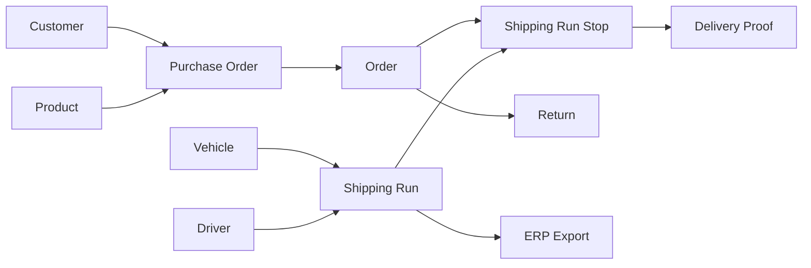
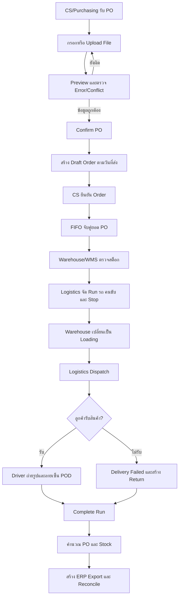
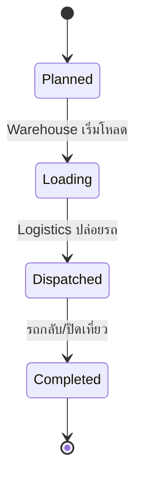
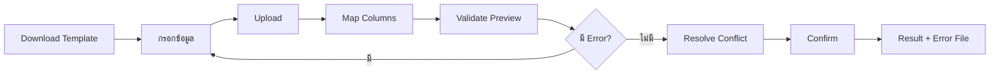
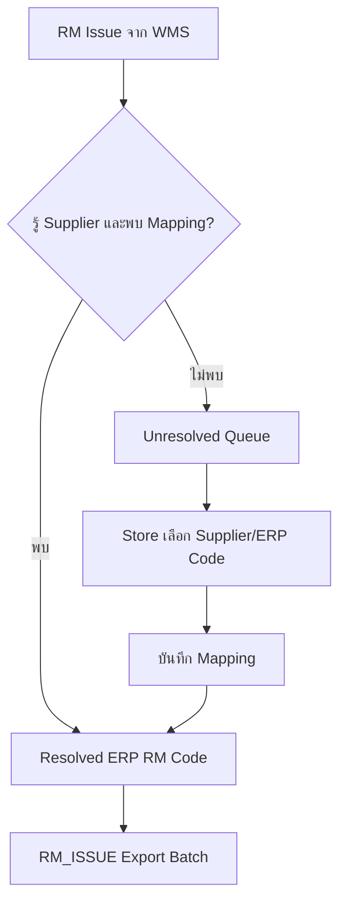
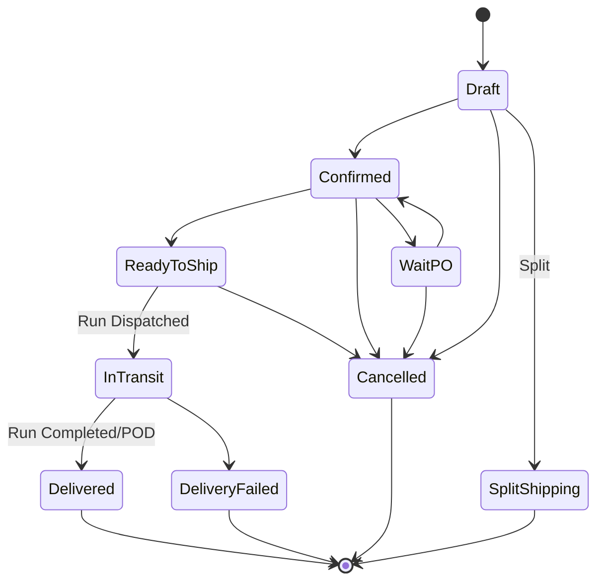
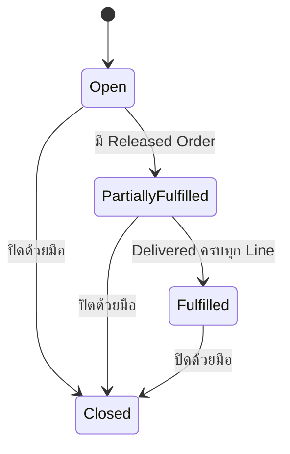
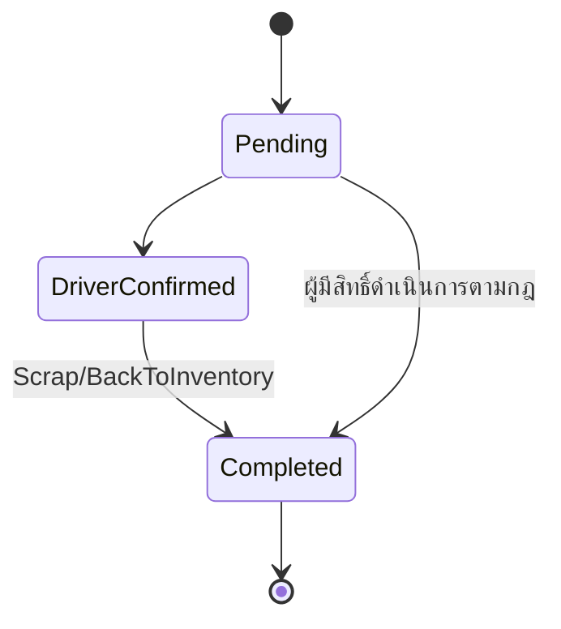

# คู่มือการใช้งาน OPT Shipping Work Plan v2

> คู่มือสำหรับผู้ใช้งานเริ่มต้น ตั้งแต่ทำความเข้าใจกระบวนการ เข้าสู่ระบบ ทำงานประจำวัน ไปจนถึงแก้ปัญหาเบื้องต้น

| รายการ | รายละเอียด |
|---|---|
| เวอร์ชันคู่มือ | 1.0 |
| ปรับปรุงล่าสุด | 20 กรกฎาคม 2026 |
| ระบบ | OPT Shipping Work Plan v2 |
| สถานะระบบ | P0 Foundation พร้อม; P1–P3 มี vertical slice ระดับโครงสร้างตั้งแต่ Customer/Product/Fleet → PO/Order → Delivery และผ่าน smoke test ในเครื่อง แต่ยังไม่ผ่าน production gate |
| กลุ่มผู้อ่าน | CS, Purchasing, Warehouse, Logistics, Production, Driver, Branch Admin, Super Admin |

หลักฐานการทดสอบและข้อจำกัดการส่งมอบล่าสุดอยู่ที่ [TestEvidence.md](./TestEvidence.md) โดย PASS ครอบคลุมเฉพาะ scope ที่ implement และ execute แล้ว ไม่ใช่ production sign-off ทั้ง TestSpec

ข้อเสนอการเปลี่ยนแปลงกฎกลาง, FIFO หลาย PO และ Inventory/WMS freshness อยู่ที่ [DesignChangeProposal-001.md](./DesignChangeProposal-001.md) สถานะ Proposed และยังไม่อนุญาตให้เปลี่ยน schema/business logic จนกว่าผู้ออกแบบระบบจะอนุมัติ

## สารบัญ

1. [ระบบนี้ใช้ทำอะไร](#1-ระบบนี้ใช้ทำอะไร)
2. [สิ่งที่ผู้เริ่มต้นควรรู้](#2-สิ่งที่ผู้เริ่มต้นควรรู้)
3. [ผู้ใช้งานและบทบาท](#3-ผู้ใช้งานและบทบาท)
4. [ภาพรวมกระบวนการทั้งหมด](#4-ภาพรวมกระบวนการทั้งหมด)
5. [เริ่มใช้งานครั้งแรก](#5-เริ่มใช้งานครั้งแรก)
6. [โครงสร้างหน้าจอ](#6-โครงสร้างหน้าจอ)
7. [คู่มือ CS และ Purchasing](#7-คู่มือ-cs-และ-purchasing)
8. [คู่มือ Warehouse](#8-คู่มือ-warehouse)
9. [คู่มือ Logistics](#9-คู่มือ-logistics)
10. [คู่มือ Driver](#10-คู่มือ-driver)
11. [คู่มือ Production](#11-คู่มือ-production)
12. [คู่มือ Admin](#12-คู่มือ-admin)
13. [การนำเข้าข้อมูลด้วยไฟล์](#13-การนำเข้าข้อมูลด้วยไฟล์)
14. [WMS, ERP และ RM Mapping](#14-wms-erp-และ-rm-mapping)
15. [สถานะและกฎสำคัญ](#15-สถานะและกฎสำคัญ)
16. [รายงานและเอกสาร](#16-รายงานและเอกสาร)
17. [ข้อความแจ้งเตือนและการแก้ปัญหา](#17-ข้อความแจ้งเตือนและการแก้ปัญหา)
18. [ความปลอดภัยและข้อมูลส่วนบุคคล](#18-ความปลอดภัยและข้อมูลส่วนบุคคล)
19. [คำศัพท์ทางธุรกิจ](#19-คำศัพท์ทางธุรกิจ)
20. [คำศัพท์ทางเทคนิค](#20-คำศัพท์ทางเทคนิค)
21. [ผู้ดูแลระบบและนักพัฒนา](#21-ผู้ดูแลระบบและนักพัฒนา)

---

## 1. ระบบนี้ใช้ทำอะไร

OPT Shipping Work Plan เป็นระบบเว็บส่วนกลางสำหรับควบคุมกระบวนการส่งสินค้า เริ่มตั้งแต่รับใบสั่งซื้อของลูกค้า วางแผน Order ตรวจสต็อก จัดรถและคนขับ โหลดสินค้า ส่งสินค้า เก็บหลักฐานการส่งมอบ จัดการของคืน และส่งข้อมูลให้ ERP

ระบบออกแบบให้ทุกฝ่ายดูข้อเท็จจริงชุดเดียว ลดการคัดลอก Excel และลดความคลาดเคลื่อนจากการสื่อสารหลายช่องทาง

### 1.1 ผลลัพธ์หลักที่ระบบต้องทำให้ได้

- Order ไม่เกินยอด PO โดยไม่แจ้งเตือน
- ผู้วางแผนเห็นสต็อกและเวลาที่ WMS sync ล่าสุด
- รถ คนขับ และจุดส่งอยู่ในแผนรายวันเดียวกัน
- สถานะ Order เปลี่ยนตามการทำงานจริง ไม่ข้ามขั้น
- คนขับบันทึก POD ด้วยโทรศัพท์มือถือ
- Delivery Failed สร้างรายการ Return ที่ติดตามย้อนหลังได้
- ไฟล์ ERP มีที่มา ช่วงวันที่ จำนวนรายการ และสถานะชัดเจน
- ทุกข้อมูลถูกจำกัดตามสาขาและสิทธิ์ของผู้ใช้

### 1.2 สิ่งที่ระบบไม่ทำ

- ไม่แทนที่ ERP หรือ WMS
- ไม่คำนวณเส้นทางหรือ GPS tracking
- ไม่มี customer portal
- ไม่มี offline mode
- ไม่ส่ง SMS, email หรือ push notification
- ไม่แก้รหัส master ใน ERP โดยตรง

---

## 2. สิ่งที่ผู้เริ่มต้นควรรู้

### 2.1 หลักคิด 5 ข้อ

1. **เลือกสาขาให้ถูกก่อนทำงาน** — ข้อมูลทุกใบผูกกับ Branch
2. **ดูสถานะก่อนกดปุ่ม** — ปุ่มที่ใช้ได้ขึ้นกับสถานะและบทบาท
3. **อย่าแก้ยอดสต็อกโดยตรง** — ใช้ Receive หรือ Adjust เพื่อให้มี Movement History
4. **ตรวจ Preview ก่อน Confirm** — โดยเฉพาะการนำเข้า PO/Product/Stock
5. **ถ้าข้อมูลไม่ชัด ระบบจะไม่เดา** — เช่น RM ที่หา Supplier ไม่พบจะเข้ารายการค้าง

### 2.2 ลำดับข้อมูลหลัก



### 2.3 สถานะปัจจุบันของผลิตภัณฑ์

โครงการมี foundation, authentication, protected dashboard, branch context และ vertical slice สำหรับ Customer, Product, Fleet, PO, Order, Delivery, Return และ Inventory แล้ว รวม price history, PO balance, Order split, recurring schedules, Day Board, POD metadata, Delivery Failed, Return resolution และ immutable stock movement ฟังก์ชันขั้นสูง เช่น import/preview, bulk/FIFO หลาย PO, file/signature storage, production planning, integration, performance และ security/UAT เต็มรูปแบบ ยังอยู่ในเฟสถัดไป จึงยังไม่ควรใช้กับ production จริง

---

## 3. ผู้ใช้งานและบทบาท

บัญชีหนึ่งมีได้หลายบทบาท และเข้าถึงได้หลายสาขาตามที่ Admin กำหนด

| บทบาท | งานหลัก | ตัวอย่างสิ่งที่ทำได้ |
|---|---|---|
| Super Admin | ดูแลทั้งระบบ | ผู้ใช้ บทบาท สาขา audit และข้อมูลทุกสาขา |
| Branch Admin | ดูแลสาขา | master data และงานปฏิบัติการในสาขาที่ได้รับสิทธิ์ |
| CS | รับความต้องการลูกค้า | ลูกค้า PO Order ติดตามส่ง รายงาน |
| Purchasing | ดูแล PO | สร้าง/นำเข้า/แก้ไข PO ตามกฎ |
| Logistics | วางแผนและปล่อยรถ | Day Board, Run, Driver, Dispatch, POD follow-up |
| Warehouse | คลังและโหลดสินค้า | Stock, Movement, Loading, Return, WMS/RM |
| Production | แผนผลิต | สร้างและ Complete Production Plan |
| Driver | งานส่งของของตน | My Daily Runs, Stop, POD, Delivery Failed |

> การไม่เห็นเมนูอาจเกิดจากบทบาทไม่อนุญาต, ไม่ได้รับสิทธิ์สาขา หรือ feature ยังไม่เปิดใช้ ให้ติดต่อ Admin พร้อมแจ้งชื่อหน้าและสาขา

---

## 4. ภาพรวมกระบวนการทั้งหมด

### 4.1 กระบวนการตั้งแต่รับ PO ถึงปิดงาน



### 4.2 ใครทำอะไรในแต่ละช่วง

| ช่วง | ผู้รับผิดชอบหลัก | ข้อมูลเข้า | ผลลัพธ์ |
|---|---|---|---|
| รับคำสั่งซื้อ | CS/Purchasing | PO ลูกค้า | PO + Draft Orders |
| ตรวจความพร้อม | CS/Warehouse | Order, PO Balance, Stock | Confirmed/Wait-PO |
| วางแผนส่ง | Logistics | Orders, Schedule, Fleet | Shipping Run + Stops |
| เตรียม/ปล่อยรถ | Warehouse/Logistics | Run plan | Loading→Dispatched |
| ส่งสินค้า | Driver | My Daily Runs | POD หรือ Delivery Failed |
| ปิดงาน | Logistics/CS | Run/POD/Return | Completed + PO recalculation |
| บันทึก ERP | Store/Accounting | Completed movements/RM | Export Batch + reconciliation |

---

## 5. เริ่มใช้งานครั้งแรก

### 5.1 สิ่งที่ต้องมี

- บัญชี email และรหัสผ่านที่ Admin สร้างให้
- บทบาทที่ตรงกับหน้าที่
- Branch Grant อย่างน้อยหนึ่งสาขา
- Chrome, Edge หรือ Safari รุ่นที่องค์กรรองรับ
- คนขับต้องมีโทรศัพท์ที่เปิดกล้องและอินเทอร์เน็ตได้

### 5.2 เข้าสู่ระบบ

1. เปิด URL ระบบที่ IT แจ้ง
2. กรอก Email
3. กรอกรหัสผ่าน
4. กด **เข้าสู่ระบบ** หนึ่งครั้งและรอผล
5. ถ้าสำเร็จ ระบบนำไป Dashboard หรือหน้าหลักของบทบาท
6. ตรวจชื่อผู้ใช้และ Active Branch ที่ Header

หากกรอกรหัสผิดติดต่อกัน 5 ครั้ง บัญชีจะถูกพักการลองเข้าสู่ระบบ 15 นาที เพื่อป้องกันการเดารหัสผ่าน

### 5.3 เลือก Active Branch

1. กดชื่อสาขาที่ Header
2. เลือกสาขาที่ต้องการทำงาน
3. ตรวจว่าชื่อสาขาเปลี่ยนแล้วก่อนสร้างหรือแก้ข้อมูล
4. ตัวเลือก **All Branches** ใช้ดูภาพรวมเท่านั้นในหน้าที่รองรับ และแสดงเฉพาะผู้มีสิทธิ์

### 5.4 ออกจากระบบ

1. กดเมนูผู้ใช้มุมขวาบน
2. เลือก **ออกจากระบบ**
3. ปิดหน้าจอเมื่อใช้เครื่องร่วมกัน

Session มีอายุ 1 ชั่วโมงและตรวจสถานะผู้ใช้/สิทธิ์ซ้ำระหว่างใช้งาน บัญชีที่ถูกปิดจะหยุดใช้งานภายในประมาณ 5 นาที

---

## 6. โครงสร้างหน้าจอ

```text
┌─────────────────────────────────────────────────────────────────┐
│ ชื่อหน้า / Breadcrumb │ Active Branch │ Sync Status │ Help │ User │
├───────────────────┬─────────────────────────────────────────────┤
│ Sidebar           │ เนื้อหาหน้า                                 │
│ - Dashboard       │ Filter / Search / Primary Action            │
│ - PO & Orders     │ Table, Board, Form หรือ Detail              │
│ - Delivery        │                                             │
│ - Operations      │                                             │
│ - Reports         │                                             │
│ - Admin           │                                             │
└───────────────────┴─────────────────────────────────────────────┘
```

### 6.1 ส่วนประกอบที่ใช้บ่อย

- **Breadcrumb:** บอกว่ากำลังอยู่หน้าใดและย้อนกลับได้
- **Filter:** จำกัดรายการตามคำค้น สถานะ วันที่ หรือสาขา
- **Status Badge:** ป้ายสถานะ ต้องอ่านข้อความ ไม่ควรดูสีอย่างเดียว
- **Primary Action:** ปุ่มหลักของหน้า เช่น สร้าง PO หรือ Add Run
- **Action Menu:** งานรอง เช่น Edit, Print, Cancel
- **Toast:** ข้อความผลสำเร็จหรือผิดพลาดชั่วคราว
- **Error Summary:** รวมสิ่งที่ต้องแก้ในฟอร์มหรือไฟล์
- **Help:** เปิดคู่มือฉบับนี้ในระบบ

### 6.2 วิธีใช้ตารางรายการ

1. ใช้ Search หา code, ชื่อ หรือเลขเอกสาร
2. เลือก Filter ที่ต้องการ
3. กดหัวคอลัมน์เพื่อเรียง เมื่อคอลัมน์รองรับ
4. กดแถวเพื่อดูรายละเอียด
5. ใช้ Pagination เปลี่ยนหน้า
6. URL เก็บ filter/sort/page จึงคัดลอก URL ส่งให้ผู้มีสิทธิ์ดูมุมมองเดียวกันได้

---

## 7. คู่มือ CS และ Purchasing

### 7.1 เตรียม Customer และ Product

ก่อนสร้าง PO ต้องมี Customer และ Product ที่อ้างอิงได้

1. ไปที่ **Master Data → Customers**
2. ค้นด้วย Customer Code หรือ Company Name ก่อนสร้างใหม่
3. ตรวจ Branch, ที่อยู่, Tax ID, Payment Terms และ Contact
4. เพิ่ม Contact และกำหนด Default Contact เมื่อจำเป็น
5. ไปที่ **Master Data → Products**
6. ตรวจ ERP Code, Material, Color, Dimension, Unit, Price และ Customer link

ห้ามสร้าง Product ERP Code ซ้ำ ระบบใช้ ERP Code เป็นกุญแจเชื่อมต่อภายนอก

### 7.2 สร้าง PO ด้วยมือ

1. ไปที่ **Sales & Planning → Purchase Orders**
2. กด **สร้าง PO**
3. เลือก Active Branch และ Customer
4. กรอก PO Number, PO Date และข้อมูล Buyer
5. เพิ่ม Line Item: Product, Original Quantity, Unit, Unit Price
6. ระบุ Expected Delivery Date และ Time Slot ถ้ามี
7. ตรวจ Price Conflict หากราคาต่างจาก Product Catalogue
8. กด Save Draft/Preview ตามหน้าจอ
9. ตรวจ Summary แล้วกด Confirm

ถ้า Line มี Expected Delivery Date ระบบสร้าง Draft Order ให้โดยอัตโนมัติ

### 7.3 ดู PO Balance

- **Original:** จำนวนตามสัญญา
- **Released:** จำนวนใน Order ที่พ้น Draft และไม่ Cancel
- **Shipped:** จำนวนที่ Delivered แล้ว
- **Balance:** Original − Released
- **Remaining:** Original − Shipped

### 7.4 แก้ไข PO

- ลด quantity ไม่ได้ต่ำกว่า Released
- ลบ line ได้เมื่อยังไม่มี Released
- PO status คำนวณอัตโนมัติ ยกเว้น Closed ที่ผู้มีสิทธิ์กดเอง
- การเปลี่ยนราคาต้องสร้าง Product Price Log

### 7.5 สร้างและยืนยัน Order

1. ไปที่ **Orders** และกดสร้างหรือเปิด Draft ที่ระบบสร้างจาก PO
2. ตรวจ Customer, Product, Quantity, Required Date, Time Slot และ Priority
3. เลือก Order Type ให้ถูก
4. กด Confirm
5. ระบบตรวจ PO แบบ FIFO และออกเลข `SP-YYMMDD-NNNN`
6. ถ้ายอดเกิน Balance ระบบตั้ง **Wait-PO** ให้แก้ PO หรือ Quantity

### 7.6 แยกส่งสินค้า (Split Order)

1. เปิด Order ที่อนุญาตให้ Split
2. กด **Split**
3. ระบุจำนวนและวันที่ของแต่ละ Child Order
4. ตรวจผลรวมให้เท่ากับจำนวนที่ต้องจัดสรร
5. Confirm

Order ต้นฉบับจะเป็น Split-shipping และ Child ทุกใบเก็บ Parent/Root เพื่อดูย้อนหลัง

---

## 8. คู่มือ Warehouse

### 8.1 อ่านยอดสต็อก

| ค่า | ความหมาย |
|---|---|
| On-hand | จำนวนที่อยู่ในคลังตาม movement ledger |
| Reserved | Confirmed + Ready to Ship + In Transit |
| Available | On-hand − Reserved |
| Zone/Bin | ตำแหน่งจัดเก็บ |

ตรวจข้อความ **ข้อมูลล่าสุดจาก WMS เมื่อ...** ถ้า stale ให้ตรวจ sync ก่อนตัดสินใจ

### 8.2 รับสินค้าเข้า

1. ไปที่ **Operations → Inventory**
2. เลือก Product และ Branch
3. กด **Receive**
4. กรอก Quantity, Reference และ Note
5. ตรวจหน่วยและทศนิยม
6. Confirm

ระบบเพิ่ม On-hand และสร้าง INBOUND StockMovement ห้ามแก้แถว Inventory โดยตรง

### 8.3 ปรับยอด

1. เปิด Stock record
2. กด **Adjust**
3. กรอกจำนวนเพิ่ม/ลดตามรูปแบบหน้าจอ
4. ระบุเหตุผลที่ตรวจสอบได้
5. Confirm

ใช้ Adjust เฉพาะการแก้ความคลาดเคลื่อน ไม่ใช้แทน Receive/Issue ปกติ

### 8.4 โหลดสินค้า

1. เปิด **Delivery → Day Board** ตามวันและสาขา
2. ตรวจ Run, Stop Sequence, Product, Quantity และ Packs
3. ตรวจ stock warning
4. เมื่อเริ่มโหลด กด **Loading**
5. โหลดตามลำดับ/เอกสารของ Run
6. แจ้ง Logistics เมื่อพร้อม Dispatch

### 8.5 จัดการ Return

1. เปิด **Operations → Returns**
2. ตรวจ Order ต้นทาง Customer Product Quantity และเหตุผล
3. รอ/ตรวจ Driver Confirmation ถ้ามี
4. เลือก Resolution: Scrap หรือ BackToInventory
5. Complete

BackToInventory ต้องสร้าง INBOUND movement ส่วน Scrap ไม่เพิ่ม stock

---

## 9. คู่มือ Logistics

### 9.1 เปิด Day Board

1. ไปที่ **Delivery → Day Board**
2. ตรวจ Active Branch
3. เลือก Working Date; ค่าเริ่มต้นคือวันพรุ่งนี้
4. ตรวจ Unassigned Orders, Runs และ WMS last sync

### 9.2 สร้าง Run อัตโนมัติ

1. กด **Auto-generate Runs**
2. เลือก Add Missing หรือ Regenerate
3. ตรวจ Preview ของรถ/คนขับ/Time Slot
4. แก้ conflict เรื่องใบขับขี่ รถซ้ำ หรือคนขับซ้ำ
5. Confirm

Regenerate ลบเฉพาะ Planned Runs ของวันนั้นก่อนสร้างใหม่ ห้ามใช้เมื่อเริ่ม Loading แล้ว

### 9.3 สร้าง Run ด้วยมือ

1. กด **Add Run**
2. เลือก Vehicle, Primary Driver และ Co-driver ถ้ามี
3. ระบุ Departure Time และ Note to Driver
4. ระบบตรวจ License Expiry และ Vehicle Class
5. Save แล้วระบบออกเลข `DP-YYMMDD-NNNN`

### 9.4 จัด Order ลง Run

1. ลาก Order จาก Unassigned ไปยัง Run หรือใช้เมนู Assign to Run
2. เรียง Stop ด้วย drag-and-drop หรือคำสั่ง Move Before/After
3. เปิด Stop เพื่อกำหนด Time Override, In/Out System และ Note
4. ตรวจ stock/pack/capacity warning
5. บันทึก

การลากไม่ได้เปลี่ยนสถานะเป็น Dispatched โดยอัตโนมัติ

### 9.5 Dispatch และ Complete



- เมื่อ Dispatch ทุก Order ใน Run เปลี่ยนเป็น In Transit
- เมื่อ Complete Order ที่ยังไม่ terminal เปลี่ยนเป็น Delivered และระบบคำนวณ PO ใหม่
- ก่อน Complete ตรวจ stop ที่ยังไม่มี POD และรายการ Delivery Failed

### 9.6 ติดตาม POD ค้าง

1. เปิด **POD Follow-up** หรือ Run detail
2. Filter เฉพาะ Dispatched และ Missing POD
3. ติดต่อ Driver ตาม Run/Stop
4. ตรวจหลักฐานเมื่อส่งมา
5. ปิด Run เมื่อข้อมูลครบตามนโยบาย

---

## 10. คู่มือ Driver

### 10.1 เปิดเที่ยวของฉัน

1. เข้าสู่ระบบด้วยโทรศัพท์
2. หน้าแรกแสดง **My Daily Runs**
3. เลือก Run ของวันนี้
4. ตรวจทะเบียนรถ เวลา Note และจำนวน Stop
5. เลือก Stop ตามลำดับ

Driver ที่มีบทบาทเดียวเห็นเฉพาะเที่ยวของตัวเองและรายงานที่อนุญาต

### 10.2 ส่งสำเร็จและบันทึก POD


1. ตรวจชื่อ Customer/Address/Product ก่อนส่ง
2. กด **ส่งสำเร็จ / บันทึก POD**
3. ถ่ายรูปให้เห็นเอกสารหรือสินค้าตามนโยบายบริษัท
4. กรอกชื่อผู้รับ
5. ให้ผู้รับลงลายเซ็น
6. ตรวจรูปและข้อมูลในหน้า Review
7. กด Submit หนึ่งครั้งและรอข้อความสำเร็จ

ถ้าอินเทอร์เน็ตขัดข้อง อย่ากดซ้ำต่อเนื่อง ให้รอและ Retry ตามหน้าจอ ระบบรุ่นนี้ไม่มี offline mode

### 10.3 ส่งไม่สำเร็จ

1. กด **Delivery Failed**
2. เลือก/ระบุเหตุผลจริง
3. เพิ่ม Note หรือรูปตามที่ระบบขอ
4. Confirm
5. ระบบสร้าง Return เชื่อมกับ Order โดยอัตโนมัติ
6. แจ้ง Logistics/Warehouse ตามขั้นตอนบริษัท

---

## 11. คู่มือ Production

### 11.1 สร้าง Production Plan

1. ไปที่ **Operations → Production Plans**
2. กด **สร้างแผนผลิต**
3. เลือก Branch และ Product
4. กรอก Planned Quantity, Start Date, Due Date และ Note
5. Save สถานะ Planned

### 11.2 Complete แผนผลิต

1. เปิด Plan ที่ผลิตเสร็จ
2. ตรวจ Product/Quantity/Branch
3. กด Complete และ Confirm
4. ระบบสร้าง INBOUND StockMovement

ห้าม Complete ซ้ำ หากจำนวนผลิตจริงต่างจากแผน ให้ใช้ flow ที่ระบบกำหนด ไม่แก้ Stock row ตรง ๆ

---

## 12. คู่มือ Admin

### 12.1 สร้างผู้ใช้

1. ไปที่ **Administration → Users**
2. กด **สร้างผู้ใช้**
3. กรอก Name, Email และรหัสผ่านเริ่มต้น
4. เลือก Role อย่างน้อยหนึ่งรายการ
5. เลือก Branch Grants
6. ถ้าเป็น Driver ให้ Link Driver record
7. Save และแจ้งผู้ใช้ผ่านช่องทางที่ปลอดภัย

เฉพาะ Super Admin ให้สิทธิ์ Super Admin ได้

### 12.2 ปิดผู้ใช้

1. เปิด User detail
2. เปลี่ยน Active เป็น No
3. ระบุเหตุผล/บันทึกตามนโยบาย
4. Save

Session ที่ใช้อยู่จะถูกปฏิเสธภายในรอบตรวจสิทธิ์ไม่เกินประมาณ 5 นาที

### 12.3 ดู Audit

ค้นด้วย Entity Type, Entity ID, User, Branch, Action และ Date Range แล้วตรวจ Before/After snapshot การเปลี่ยนสิทธิ์ export และ cross-branch action เป็นเหตุการณ์สำคัญ

---

## 13. การนำเข้าข้อมูลด้วยไฟล์

รองรับ Customers, Products, Inventory, Drivers, Vehicles และ Purchase Orders ตามเฟสที่เปิดใช้

### 13.1 กระบวนการมาตรฐาน



1. ดาวน์โหลด template จากหน้าที่ต้องการ
2. ห้ามเปลี่ยนชื่อคอลัมน์บังคับ
3. กรอกหนึ่ง record ต่อแถว ไม่ merge cell
4. ใช้ code ที่มีในระบบสำหรับ reference
5. Upload ไฟล์
6. ตรวจ Column Mapping
7. ตรวจ Preview: Valid, Warning, Error
8. แก้ Not Found/Ambiguous/Duplicate/Price Conflict
9. เลือก New/Keep/Replace เมื่อข้อมูลชนของเดิม
10. Confirm เมื่อ Error เป็นศูนย์
11. เก็บ Result และดาวน์โหลด Error File ถ้ามี

### 13.2 ความหมายของผลตรวจ

| ผล | ความหมาย | วิธีดำเนินการ |
|---|---|---|
| Resolved | อ้างอิงได้หนึ่งรายการ | ตรวจแล้วไปต่อ |
| Not Found | ไม่พบ code/name | แก้ไฟล์หรือสร้าง master ก่อน |
| Ambiguous | พบมากกว่าหนึ่งรายการ | ใช้ unique code หรือเลือกให้ชัด |
| Duplicate | ข้อมูลซ้ำในไฟล์/ระบบ | Keep, Replace หรือเอาแถวซ้ำออก |
| Price Conflict | ราคา PO ต่างจาก catalogue | ผู้มีสิทธิ์ยืนยันและบันทึก price history |
| Invalid Format | รูปแบบวันที่/จำนวน/ค่าไม่ถูก | แก้ตามข้อความระดับ row/column |

ระบบไม่เขียนข้อมูลจริงระหว่าง Preview

---

## 14. WMS, ERP และ RM Mapping

### 14.1 WMS Sync

1. Warehouse/ระบบรับ CSV หรือ Excel ตามรอบ
2. ระบบตรวจ schema, hash, row count และ reference
3. แถวผิดถูก reject พร้อมเหตุผล
4. ข้อมูลที่ถูก apply แบบ idempotent เพื่อไม่บันทึกซ้ำ
5. หน้าจอแสดง Last Successful Sync

ถ้า Sync Failed หรือ stale ห้ามสรุปว่ายอดบนหน้าจอเป็นยอดปัจจุบันโดยไม่ตรวจสอบ

### 14.2 RM Mapping



1. เปิด **Integration → RM Unresolved**
2. ตรวจ WMS RM ID, Roll/QR, Quantity, Issue Time และข้อมูลรับเข้า
3. เลือก Supplier ที่ถูกต้อง
4. เลือก ERP RM Code
5. บันทึก mapping สำหรับครั้งต่อไป
6. ตรวจ record เปลี่ยน Pending→Resolved

ห้ามเลือกจากการคาดเดา ถ้าไม่มีหลักฐานให้คง Pending และประสานเจ้าของข้อมูล

### 14.3 ERP Export

1. เปิด **Integration → ERP Export Batches**
2. เลือก Batch Type: FG_MOVEMENT หรือ RM_ISSUE
3. เลือก Branch และ Date Range
4. Preview จำนวน record และข้อผิดพลาด
5. Generate File
6. นำเข้า ERP ตามสิทธิ์และคู่มือ ERP
7. ตรวจ control total/error report
8. Mark Reconciled/Failed พร้อมหลักฐาน

อย่าสร้าง batch ซ้ำเพื่อแก้ปัญหาโดยไม่ตรวจว่า record เดิมถูก import แล้วหรือไม่

---

## 15. สถานะและกฎสำคัญ

### 15.1 Order State



In Transit และ Delivered ห้ามตั้งด้วยมือจาก Order page

### 15.2 PO State



### 15.3 Return State



---

## 16. รายงานและเอกสาร

| รายงาน/เอกสาร | ใช้เมื่อ | ผู้ใช้หลัก |
|---|---|---|
| Daily Report | ติดตาม driver→run→stops รายวัน | Admin, Logistics, CS, Driver ตามสิทธิ์ |
| Orders Report | วิเคราะห์ Order ตามวันที่/สถานะ | CS, Management |
| Utilization | รถ/คนขับ scheduled เทียบ actual | Logistics, Management |
| Run Report | ตรวจรายละเอียดเที่ยว | Logistics, Warehouse, Driver |
| Manifest | รายการสินค้าในเที่ยว | Warehouse/Logistics |
| Delivery Note | เอกสารประกอบการส่ง | CS/Driver/Customer |
| POD Follow-up | หาจุดส่งที่ขาดหลักฐาน | Logistics |
| RM Unresolved | ปิด mapping ที่ยังไม่พบ | Store/Warehouse |

PDF ต้องแสดงภาษาไทยด้วยฟอนต์ Sarabun และถูกจำกัดตาม Branch

---

## 17. ข้อความแจ้งเตือนและการแก้ปัญหา

| อาการ/ข้อความ | สาเหตุที่พบบ่อย | วิธีตรวจและแก้ |
|---|---|---|
| Branch access denied | ไม่มี grant หรือเลือกสาขาผิด | ตรวจ Active Branch แล้วติดต่อ Admin |
| Forbidden | Role ไม่มี permission | ตรวจบทบาท; อย่าพยายามใช้ URL ข้ามสิทธิ์ |
| Session expired | ครบเวลา/ถูกปิดบัญชี | Login ใหม่; ติดต่อ Admin ถ้ายังเกิด |
| Account locked | รหัสผิดครบ 5 ครั้ง | รอ 15 นาทีหรือติดต่อ Admin |
| PO balance changed | มีคนทำรายการพร้อมกัน | Reload ตรวจ Balance แล้วทำใหม่ |
| Wait-PO | Quantity เกิน PO Balance | แก้ Quantity/PO ตามอำนาจอนุมัติ |
| Driver license expired | ใบขับขี่หมดอายุ | แก้ master/เปลี่ยนคนขับก่อนสร้าง Run |
| Vehicle class mismatch | คนขับไม่มี class ที่รถต้องใช้ | เลือกคนขับที่ถูกต้องหรือแก้ข้อมูลใบอนุญาต |
| WMS data stale | Sync ล่าสุดเกิน SLA | ตรวจ WMS Sync Log/ไฟล์ต้นทาง |
| Upload row error | code/format/reference ผิด | Filter Error แล้วแก้ตาม row/column |
| POD upload failed | network/file type/size | ตรวจอินเทอร์เน็ต รูป และ Retry หนึ่งครั้ง |
| Duplicate export | record อยู่ใน batch แล้ว | ตรวจ Batch เดิมและ reconciliation ก่อน retry |

เมื่อแจ้ง IT ให้ส่ง: เวลาเกิด, User, Branch, URL/หน้า, เลข SP/DP/PO, ข้อความ error และ Request ID โดยไม่ส่งรหัสผ่านหรือ token

---

## 18. ความปลอดภัยและข้อมูลส่วนบุคคล

- ใช้บัญชีของตนเอง ห้ามแชร์รหัสผ่าน
- ตรวจ Branch ก่อนเปิด/ส่งออกข้อมูล
- POD, ชื่อ, เบอร์โทร, email และลายเซ็นเป็นข้อมูลส่วนบุคคล
- ดาวน์โหลด/ส่งต่อเฉพาะตามหน้าที่และช่องทางที่องค์กรอนุมัติ
- ห้ามใส่ข้อมูลจริงลง ticket สาธารณะหรือ repository
- ออกจากระบบเมื่อใช้เครื่องร่วมกัน
- รายงานอุปกรณ์สูญหายหรือบัญชีผิดปกติให้ IT ทันที

---

## 19. คำศัพท์ทางธุรกิจ

| Term | คำอธิบาย |
|---|---|
| Branch | สาขาเจ้าของข้อมูลและขอบเขตสิทธิ์ |
| Customer | ลูกค้าที่สั่งซื้อ/รับสินค้า |
| Product | สินค้าหรือชิ้นส่วน ใช้ ERP Code เป็น key ภายนอก |
| PO | Purchase Order ใบสั่งซื้อของลูกค้า |
| PO Line | รายการสินค้าและจำนวนภายใน PO |
| Order | ความต้องการส่งสินค้าหนึ่ง Product ต่อหนึ่งใบ |
| Released | จำนวน Order ที่พ้น Draft และไม่ Cancel ซึ่งกิน PO Balance |
| Balance | Original − Released; ยอดที่ยังนำไปสร้าง commitment ได้ |
| Remaining | Original − Shipped; ยอดที่ยังส่งไม่ครบ |
| FIFO | ใช้ PO เก่าที่มี Balance ก่อนตามลำดับวันที่ |
| Wait-PO | Order ที่รอเพราะ PO Balance ไม่พอ |
| Split Shipping | แยก Order เป็น Child หลายวัน/จำนวน |
| Shipping Run | เที่ยวรถหนึ่งคันในวัน/ช่วงเวลาหนึ่ง |
| Stop | Order ที่ถูกจัดเป็นจุดส่งใน Run พร้อมลำดับ |
| SP Number | เลข Order รูปแบบ SP-YYMMDD-NNNN |
| DP Number | เลข Run รูปแบบ DP-YYMMDD-NNNN |
| POD | Proof of Delivery รูป/ลายเซ็น/ชื่อผู้รับ/เวลาส่ง |
| On-hand | สินค้าที่มีตาม movement ledger |
| Reserved | จำนวนที่ถูก commitment โดย Order ที่กำหนด |
| Available | On-hand − Reserved |
| Movement Ledger | ประวัติเปลี่ยน stock แบบเพิ่มรายการ ห้ามแก้ย้อนหลัง |
| Return | ของคืนจากการส่งไม่สำเร็จหรือสร้างด้วยมือ |
| WMS | Warehouse Management System ระบบคลังต้นทาง |
| ERP | Enterprise Resource Planning ระบบบัญชี/ทรัพยากรองค์กร |
| RM | Raw Material วัตถุดิบ |
| FG | Finished Goods สินค้าสำเร็จรูป |
| RM Mapping | การจับคู่ WMS RM + Supplier กับ ERP RM Code |
| Reconciliation | การเทียบข้อมูลส่งออกกับผลบันทึกจริงใน ERP |

---

## 20. คำศัพท์ทางเทคนิค

| Term | คำอธิบายแบบผู้เริ่มต้น |
|---|---|
| Authentication | การพิสูจน์ว่า “คุณเป็นใคร” เช่น email+password |
| Authorization | การตรวจว่า “คุณทำอะไรได้” หลังรู้ตัวตนแล้ว |
| Role/RBAC | ชุดสิทธิ์ตามบทบาทงาน เช่น CS หรือ Logistics |
| Branch Scope | เงื่อนไขบังคับให้ query/action อยู่ในสาขาที่ได้รับสิทธิ์ |
| Session | สถานะการ Login ที่มีอายุจำกัด |
| JWT | Token ที่ระบบลงลายเซ็นเพื่อบรรจุข้อมูล session; ผู้ใช้ไม่ควรคัดลอกหรือเปิดเผย |
| bcrypt | วิธี hash รหัสผ่านแบบ one-way ระบบไม่เก็บรหัสผ่านจริง |
| Transaction | กลุ่มการเปลี่ยนข้อมูลที่สำเร็จทั้งหมดหรือยกเลิกทั้งหมด |
| Serializable | ระดับ transaction ที่ทำให้งานพร้อมกันให้ผลเสมือนทำทีละงาน ใช้กัน oversell/เลขซ้ำ |
| Atomic Counter | ตัวนับเลขที่เพิ่มอย่างแยกไม่ได้ ป้องกันสองคนได้เลขเดียวกัน |
| Idempotency | ส่งคำสั่งเดิมซ้ำแล้วไม่สร้างผลทางธุรกิจซ้ำ เช่น POD/export |
| Validation | ตรวจรูปแบบและกฎก่อนบันทึก เช่น quantity ต้องบวก |
| Schema | โครงสร้างข้อมูล ตาราง field ชนิดข้อมูลและ constraint |
| Migration | ประวัติคำสั่งปรับ schema จากรุ่นหนึ่งไปอีกรุ่นหนึ่ง |
| ORM/Prisma | เครื่องมือให้โค้ด TypeScript อ่าน/เขียน PostgreSQL แบบมี type |
| PostgreSQL | ฐานข้อมูลหลักของระบบ |
| Server Action/API | จุดรับคำสั่งจาก UI ไปทำงานที่ server ซึ่งต้องตรวจสิทธิ์ใหม่ทุกครั้ง |
| Adapter | ส่วนแปลงรูปแบบ WMS/ERP ให้เข้ากับภาษากลางของระบบ |
| CSV/XLSX | รูปแบบไฟล์ตารางสำหรับ import/export |
| Checksum/Hash | ลายนิ้วมือของไฟล์ ใช้ตรวจว่าไฟล์เดิมถูกนำมาซ้ำหรือถูกเปลี่ยน |
| CI | ระบบอัตโนมัติที่ติดตั้ง dependency และตรวจ lint/type/schema/test เมื่อ push code |
| Unit Test | ทดสอบกฎส่วนเล็ก เช่น lockout หรือ PO calculation |
| Integration Test | ทดสอบหลายส่วนร่วมกัน เช่น transaction กับ database |
| E2E Test | ทดสอบกระบวนการผ่าน UI ตั้งแต่ต้นจนจบ |
| Audit Log | บันทึกว่าใครทำอะไร เมื่อใด กับข้อมูลใด ก่อน/หลัง |
| Request ID | รหัสติดตามคำขอหนึ่งครั้ง ใช้ค้น log เมื่อเกิดปัญหา |
| Stale Data | ข้อมูลที่เก่าเกินช่วงเวลาที่เชื่อถือได้ |
| Responsive UI | หน้าจอปรับตาม desktop/tablet/mobile |
| Accessibility | การออกแบบให้ใช้ keyboard, screen reader และมองเห็น focus/contrast ได้ |
| PDPA | กฎหมายคุ้มครองข้อมูลส่วนบุคคลของไทย |

---

## 21. ผู้ดูแลระบบและนักพัฒนา

ส่วนนี้ไม่จำเป็นสำหรับผู้ใช้ทั่วไป

### 21.1 Technology Baseline

- Next.js 15.5.20, React 19, TypeScript strict
- Prisma 6.19 + PostgreSQL 16
- JWT (`jose`), bcrypt, Zod
- Vitest และ GitHub Actions
- Mermaid + React Markdown สำหรับ Help View

### 21.2 เริ่มระบบ Development

```bash
cp .env.example .env
docker compose up -d
npm ci
npm run db:migrate -- --name init
npm run db:seed
npm run dev
```

เปิด `http://localhost:3000` และหน้า Help ที่ `http://localhost:3000/help`

### 21.3 คำสั่งตรวจคุณภาพ

```bash
npm run lint
npm run typecheck
npm run prisma:validate
npm test
npm run build
```

ห้าม commit `.env`, credential, token, production data หรือ POD จริง

### 21.4 เอกสารอ้างอิง

- `designspec.md` — requirement/design/UX/UI baseline
- `PRD.md` — functional requirements และ data dictionary
- `SYSTEM_DESIGN.md` — architecture และ phases
- `UML_MODEL.md` — UML/state/data diagrams
- `prisma/schema.prisma` — executable data schema

---

## ขอความช่วยเหลือ

1. เปิดปุ่ม **Help** และค้นหาหัวข้อที่เกี่ยวข้อง
2. จด Request ID หรือข้อความ error
3. แจ้งหัวหน้างานหรือ IT พร้อม User, Branch, เวลา, หน้า และเลขเอกสาร
4. ห้ามส่ง password, session token หรือข้อมูลส่วนบุคคลเกินจำเป็น

คู่มือนี้ต้องได้รับการปรับปรุงเมื่อ workflow, role, status, menu, import template หรือ integration contract เปลี่ยน
